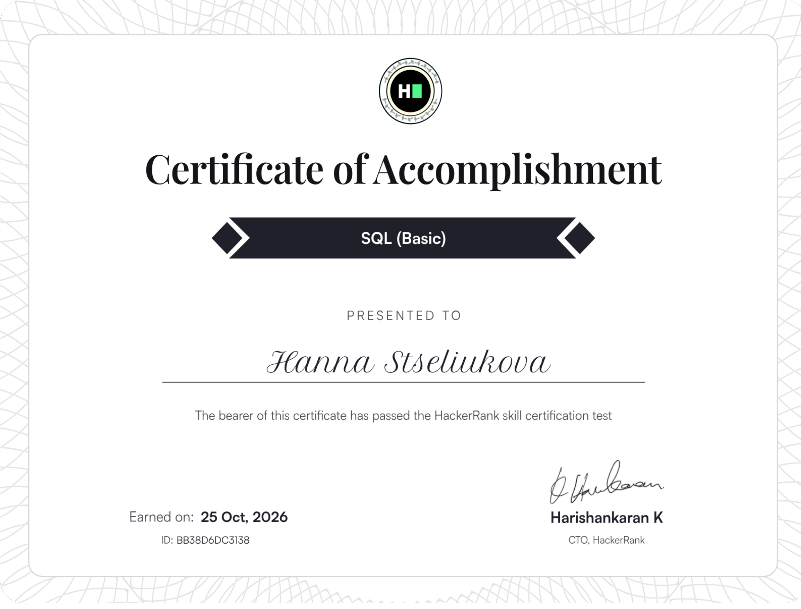

# SQL — Basic

My HackerRank SQL (Basic) certificate and solutions to HackerRank SQL challenges.

## Certificate

HackerRank **SQL (Basic)**: [certificate link](https://www.hackerrank.com/certificates/bb38d6dc3138)



## Skills

The SQL (Basic) skill is described in the [HackerRank Skills Directory](https://www.hackerrank.com/skills-directory/sql_basic). It consists of seven topics:

| # | Topic | What it covers |
|---|-------|----------------|
| 1 | Introduction to SQL | setting up a database environment, understanding what SQL is used for |
| 2 | Basic SQL queries | `SELECT`, choosing columns, filtering with `WHERE` |
| 3 | Data Definition Language (DDL) | `CREATE`, `ALTER`, `DROP` |
| 4 | Data Manipulation Language (DML) | `INSERT`, `UPDATE`, `DELETE` |
| 5 | Basic functions and expressions | `COUNT`, `SUM`, `AVG`, `MIN`, `MAX` |
| 6 | Sorting and limiting results | `ORDER BY`, `LIMIT` |
| 7 | Joins | `INNER JOIN`, `LEFT JOIN`, `RIGHT JOIN`, `FULL JOIN` |

## Solutions

This repository contains my solutions to HackerRank SQL challenges.

```
sql-basic-solutions/
├── README.md
├── basic-select/        # SELECT, WHERE, ORDER BY, LIMIT
├── aggregation/         # COUNT, SUM, AVG, MIN, MAX, GROUP BY
├── basic-join/          # INNER, LEFT, RIGHT joins
└── screenshots/
```

Folder names match the section names on HackerRank. Files are numbered and named after the challenge, for example `01_revising_the_select_query_i.sql`.

### Solution format

Each file starts with the challenge name, a link, a short description in my own words, and the difficulty, followed by the query:

```sql
-- Challenge: Revising the Select Query I
-- Link: https://www.hackerrank.com/challenges/revising-the-select-query/problem
-- Task: select all columns for US cities with a population above 100000
-- Difficulty: Easy

SELECT *
FROM CITY
WHERE COUNTRYCODE = 'USA'
  AND POPULATION > 100000;
```

## Note

Challenge statements belong to HackerRank. This repository contains only links, short paraphrases, and my solutions.
